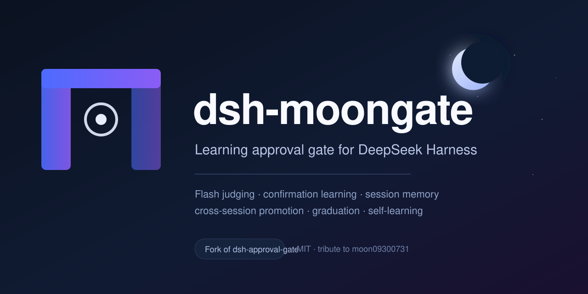
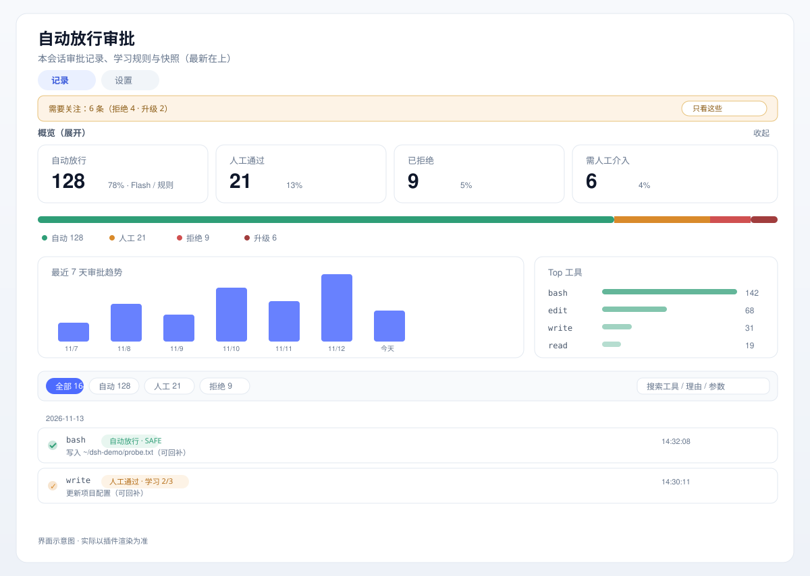
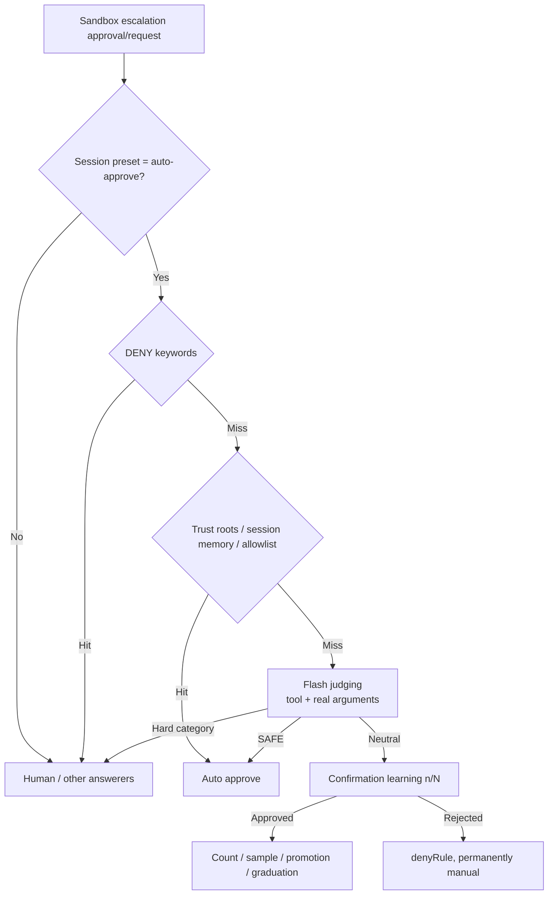

# dsh-moongate

**An auto-approval gate for DeepSeek Harness that learns from your approvals.**

> Fewer clicks over time: safe operations run automatically, repeated operations graduate into rules, dangerous operations always go to you.
>
> **Tribute to upstream**: built on [moon09300731/dsh-approval-gate](https://github.com/moon09300731/dsh-approval-gate) v0.5.0 (MIT). The name `moongate` is a nod to the author's handle `moon09300731`. See [Credits](#credits).

[简体中文](README.md) · [English](README.en.md)

[](LICENSE)
[](https://www.deepseek.com/harness/)
[](https://github.com/suiyideali/dsh-moongate/actions/workflows/ci.yml)
[](#contributing)
[](https://github.com/suiyideali/dsh-moongate)

DeepSeek Harness asks before running commands and modifying files. In real use most requests are safe, so approval turns into click fatigue. `dsh-moongate` does three things:

1. **Judge first**: sandbox escalations go to Flash, using the real tool-call arguments rather than model-written justifications;
2. **Learn from your decisions**: approvals are remembered per session, promoted across sessions, and graduated into rules — without extra interactions;
3. **Stay transparent and controllable**: a rule library with sources/hits/evidence, enable/disable/export, plus a dashboard with stats, trends and filters.

Deletion, credentials, remote/production, system paths and bulk irreversible operations are **never auto-approved and never learned**.

---

## Contents

- [Why](#why)
- [Features](#features)
- [Install](#install)
- [Quick start](#quick-start)
- [UI](#ui)
- [How it works](#how-it-works)
- [Learning model](#learning-model)
- [Configuration](#configuration)
- [Security](#security)
- [Compatibility](#compatibility)
- [Development](#development)
- [Roadmap](#roadmap)
- [FAQ](#faq)
- [Contributing](#contributing)
- [Credits](#credits)
- [License](#license)

## Why

Approval fatigue is real: users accept a very high share of permission prompts, and "Allow" becomes muscle memory. The usual extremes are:

- **Sandboxing**: safe, but every new capability needs configuration and cross-directory/network work breaks isolation;
- **Skipping permissions**: convenient, but no protection.

`dsh-moongate` takes the middle path: **model judgment + human confirmation + incremental learning**. It will not auto-approve deleting a production database, but it will remember that you approved writes in a scratch directory three times.

## Features

| Capability | Description |
| --- | --- |
| **Flash judging** | `DENY → trust roots / session memory / allowlist → Flash (SAFE / hard category / neutral) → learning` |
| **Real tool-call input** | Resolves `callId` to the actual `tool/call` arguments (redacted, truncated to 4 KB) |
| **Confirmation learning** | Neutral operations auto-approve after the threshold; fingerprint hits and semantic same-class verification |
| **Remember / forget** | One click in the approval view; path fingerprint when available, exact-description matching otherwise; reversible |
| **Trust roots** | Configure once; operations inside a directory prefix need no prompt |
| **Session memory** | The same fingerprint approved once in a session repeats without prompting |
| **Cross-session promotion** | Multi-session approvals become global rules (path fingerprint, intent signal, no deny history) |
| **Signature graduation** | Similar operations graduate into rules after enough manual confirmations (multi-fingerprint, 2 sessions) |
| **Self-learning (opt-in)** | Graduates signatures from consecutive Flash `SAFE` verdicts without human confirmation; off by default |
| **Negative feedback** | Rejecting or reverting removes the learned rule/memory and makes the pattern permanent manual |
| **Rule library** | Allow/deny/trust/graduation in one place; search, enable/disable, delete, JSON export, evidence |
| **Rule health check** | Flags generic `contains`, blanket mode rules and huge trust roots, with narrowing suggestions |
| **Reject escalation** | 3 consecutive / 20 total rejections → `escalate` event and a red "needs human" badge |
| **Two-stage judging** | Fast `ALLOW/REVIEW` screen + deep re-check; off by default |
| **Approval dashboard** | Stat cards, distribution bar, 7-day trend, top tools, filters/search, date-grouped timeline |

## Install

> Targets **DeepSeek Harness 0.2.x** (verified on 0.2.2-rc.1). Reload the plugin after host changes (toggle the plugin row or restart the app); client-only changes need a page refresh.

### Option 1: install the fork (recommended)

```sh
dsh plugin --profile desktop add github:suiyideali/dsh-moongate
# after publishing to npm:
# dsh plugin --profile desktop add dsh-moongate
```

### Option 2: patch the upstream package

```sh
dsh plugin --profile desktop add dsh-approval-gate@0.5.0
cp patches/dsh-approval-gate@0.5.0.patch ~/.dsh/profiles/desktop/patches/
# add to ~/.dsh/profiles/desktop/pnpm-workspace.yaml:
# patchedDependencies:
#   'dsh-approval-gate@0.5.0': patches/dsh-approval-gate@0.5.0.patch
cd ~/.dsh/profiles/desktop
pnpm install
```

### Permission preset (required for both)

The preset table is frozen at composition time; add one entry to the profile `cordis.patch.yml`:

```yaml
- id: permission
  name: '@deepseek-ai/dsh-permission-presets'
  config:
    presets:
      read-only:
        sandbox: read-only
        approval: ask
      workspace-write:
        sandbox: workspace-write
        approval: ask
      danger-full-access:
        sandbox: danger-full-access
        approval: never
      auto-approve:
        sandbox: workspace-write
        approval: ask
        name: 自动审批（Flash）
        description: Learning auto-approval: workspace writes run, confirmed patterns auto-approve, dangerous operations go manual.
```

After a reload, the session permission dropdown shows **自动审批（Flash）**.

## Quick start

1. Select **自动审批（Flash）** in the session permission dropdown — per session only.
2. The first time you open Settings → Auto approval → **⑥ Auto learning**, a one-time guide appears:
   - **Keep recommended (conservative)**: session memory / promotion / graduation on, self-learning off;
   - **Enable self-learning (aggressive)**: learn directly from Flash `SAFE` verdicts.
3. Work normally: safe operations run silently, uncertain ones prompt you, and approvals gradually become rules.
4. For control: **Remember this operation** per row, manage everything in **⑦ Rule library**, tune thresholds in **⑥ Auto learning**.

## UI

The approval view (right of the trajectory) is a dashboard:

- stat cards for auto / manual / rejected / needs-human, with percentages;
- a four-segment distribution bar and rule overview (total / self-learned / graduated / trust roots);
- a 7-day approval trend and top tools;
- type chips + search over tool/reason/arguments;
- a date-grouped timeline with arguments, remember/forget, and diff snapshots.



> Schematic only; the actual rendering depends on the plugin.

Settings → Auto approval has seven cards:

| Card | Content |
| --- | --- |
| ① DENY | Irreversible danger keywords |
| ② Allowlist | Auto-approve rules with source and hit count |
| ③ denyRules | Permanently manual rules |
| ④ Flash | `riskyThreshold`, `judgeTimeoutMs` |
| ⑤ Learning | Keys currently learning and their progress |
| ⑥ Auto learning | Session memory, promotion, graduation, self-learning, two-stage |
| ⑦ Rule library | Unified rule management + health check + export |

## How it works



- Only sandbox escalations go through it; normal workspace operations do not.
- Per-session gating: sessions not on the preset are untouched.
- Fail-safe: Flash timeout/error/unparseable output → manual.
- Real arguments come from `tool/call` events via `callId`, with secret redaction and an 8 KB cache cap.

## Learning model

| Layer | Signal | Scope | Default |
| --- | --- | --- | --- |
| Remember (manual) | "Remember this operation" | Global rule | Available |
| Trust roots | Explicit configuration | Directory prefix | Empty |
| Session memory | Manual approvals in this session | Session | On |
| Cross-session promotion | Manual approvals in multiple sessions | Global rule | On (2 sessions) |
| Signature graduation | Repeated manual approvals of similar ops | Global rule | On (3 / 2 sessions) |
| Self-learning | Consecutive Flash `SAFE` verdicts | Global rule | **Off** |

Self-learning is off by default because it is the only layer with no human label. When enabled, guardrails still apply: path signature, no deny history, thresholds, a 50-rule cap, and rejection/revert removes the rule and progress.

## Configuration

Everything lives in `~/.dsh/auto-approve/`; edits to `allowlist.json` are hot-reloaded.

| Field | Default | Meaning |
| --- | --- | --- |
| `denyKeywords` | built-in | Always manual |
| `allowRules` | workspace-write | Allowlist rules (`tool/mode/category/contains/signature/disabled`) |
| `denyRules` | `[]` | Permanently manual rules |
| `hardCategories` | deletion/credential/remote/system/bulk | Never learned |
| `riskyThreshold` | 3 | Neutral confirmation threshold |
| `judgeTimeoutMs` | 20000 | Flash judge timeout (1 retry) |
| `trustRoots` | `[]` | Trusted directories |
| `sessionMemory` | true | Session-scoped approval memory |
| `promotionSessions` | 2 | Sessions for cross-session promotion (3 without intent signal) |
| `graduationThreshold` | 3 | Manual confirmations for graduation (4 without intent signal) |
| `graduationSessions` | 2 | Sessions for graduation |
| `selfLearn` | false | Self-learning switch |
| `selfLearnThreshold` | 5 | Consecutive SAFE verdicts |
| `selfLearnSessions` | 2 | Sessions for self-learning |
| `selfLearnMaxRules` | 50 | Self-learned rule cap |
| `twoStage` | false | Two-stage judging switch |
| `stage1Provider` / `stage1Model` | empty | Fast-screen model |
| `denyEscalateConsecutive` | 3 | Consecutive rejection escalation |
| `denyEscalateTotal` | 20 | Total rejection escalation |

Files: `allowlist.json` (rules/config), `learning.json` (confirmation learning), `memory.json` (cross-session/graduation/self-learning progress), `audit.log`, `events.jsonl`, `snapshots/` (pre-write snapshots for diff/revert).

## Security

- Hard-risk categories are never auto-approved or learned.
- Denied fingerprints/signatures become permanently manual; rejection also removes learned rules and memory.
- Reverting an auto-approved change triggers negative feedback and removes the matching rule.
- Real arguments are redacted and truncated before model input.
- Every rule has source/createdAt/hitCount/lastHit; remember/self-learning rules carry evidence events.
- Rule health check flags generic `contains`, blanket rules, and `~`/`/` trust roots with enable/disable controls.

> ⚠️ Auto approval significantly reduces human oversight. Use in trusted environments; keep manual approval for production, payments and remote systems.

## Compatibility

- Targets **DeepSeek Harness 0.2.x**, verified on 0.2.2-rc.1.
- Includes fixes for the upstream `permissionPresets.current(session)` API and Flash `reasoningEffort: off` compatibility.
- Re-verify after DSH upgrades; issues/PRs welcome.

## Development

```sh
npm test   # node --check + smoke tests
```

CI (`.github/workflows/ci.yml`) runs syntax checks, smoke tests, verifies the patch applies to upstream `0.5.0`, and checks the license.

Local loop: host changes need a plugin reload; client changes need a page refresh; run `npm test` before committing.

## Roadmap

- [ ] Inline rule editing (enable/disable/delete today);
- [ ] Semantic reuse (generalize from a single approval);
- [ ] Shadow mode: record "would auto-approve" candidates before enabling;
- [ ] Per-project stats and trends;
- [ ] i18n for UI copy.

## FAQ

**Why is self-learning off by default?** It is the only layer without human labels; enable it in ⑥ when you accept the risk.

**Can I install it alongside upstream?** Not recommended; both compete for the `auto-approve` preset and `approval/request`.

**Where is learning data?** `~/.dsh/auto-approve/`; reinstalling the plugin does not delete it. Back it up before DSH upgrades.

**How do I trust a directory?** Add it in ⑥ or ⑦ (for example `~/src`); it bypasses prompts but not DENY/hard-risk rules.

**Why is the approval view empty?** No sandbox escalations yet, or the session is not on the auto-approve preset.

## Contributing

- Open an issue first for behavior changes;
- Keep `npm test` green and add smoke assertions for new behavior;
- Do not commit local paths, credentials or test leftovers;
- Security-semantics changes must describe the threat model and rollback.

## Credits

This project is based on **[moon09300731/dsh-approval-gate](https://github.com/moon09300731/dsh-approval-gate)** v0.5.0 (MIT):

- Upstream: <https://github.com/moon09300731/dsh-approval-gate>
- Author: moon09300731
- Inherited: Flash judging pipeline, confirmation-based learning, settings rule cards, approval view, diff revert and snapshots
- Added by this fork: real tool arguments, remember/forget, trust roots, session memory/cross-session promotion, signature graduation, self-learning, rule library, approval dashboard, and more (see [FORK-CHANGES.md](FORK-CHANGES.md))

The name `moongate` is a nod to the author's handle `moon09300731`. Thanks to the upstream author; if you like the idea, please give upstream a star.

Original copyright remains with the upstream author; modifications are released under MIT. See [LICENSE](LICENSE).

## License

[MIT](LICENSE) © 2026 moon09300731 (upstream) and dsh-moongate contributors. Modifications provided without warranty.

[](https://star-history.com/#suiyideali/dsh-moongate&Date)
