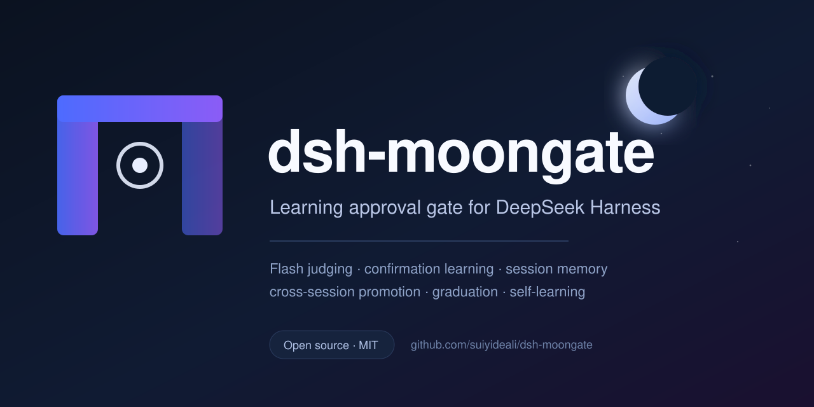
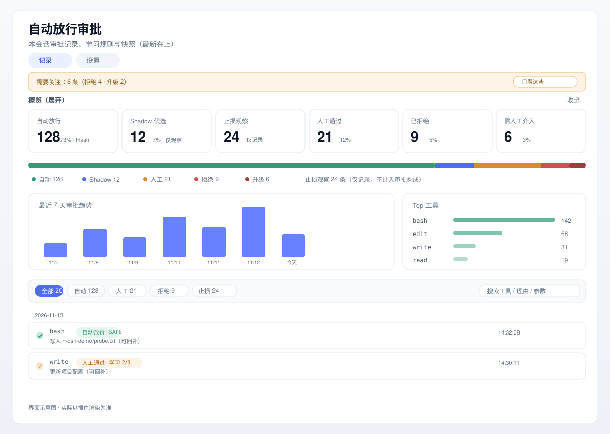
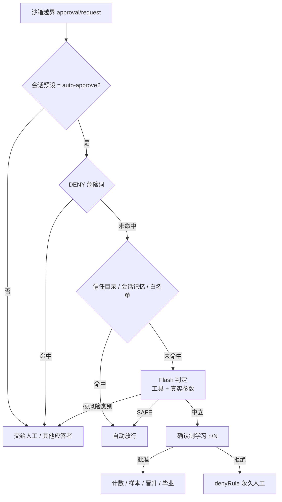

# dsh-moongate

**一个会从你的审批里学习的 DeepSeek Harness 自动审批门控。**

> 越用越少点：安全操作自动放行，同类操作确认几次后自动沉淀规则，危险操作永远交给你。
>
> **致敬原项目**：本项目基于 [moon09300731/dsh-approval-gate](https://github.com/moon09300731/dsh-approval-gate) v0.5.0（MIT）扩展而来；`moongate`（月门）取意自原作者 ID `moon09300731`。详见 [原项目](#原项目--credits)。

[简体中文](README.md) · [English](README.en.md)

[](LICENSE)
[](https://www.deepseek.com/harness/)
[](https://github.com/suiyideali/dsh-moongate/actions/workflows/ci.yml)
[](#contributing)
[](https://github.com/suiyideali/dsh-moongate)
[](https://awesome-dsh-plugin.com)
[](https://www.dsh.so/artifact/dsh-moongate/?ref=badge)

DeepSeek Harness 默认会在命令和文件修改前询问你。问题是：真实使用中大多数请求都是安全的，人会疲劳、会闭眼点"允许"——审批就变成了走过场。

`dsh-moongate` 在这个位置做三件事：

1. **先判断**：越界请求交给 Flash，结合真实 tool call 参数判断是否可回补、是否触碰敏感资源；
2. **从你的决定里学**：你批准/拒绝过的操作会被记住，本会话直接复用、跨会话晋升、同类操作毕业，全程不需要额外交互；
3. **给你透明度和控制权**：规则库、命中次数、证据事件、启停/删除/导出，以及审批页的统计、趋势与筛选。

危险类别（删除、凭据、远程/生产、系统、批量）**永不自动放行、也永不学习**。

---

## 目录

- [为什么是它](#为什么是它)
- [功能](#功能)
- [安装](#安装)
- [快速开始](#快速开始)
- [界面](#界面)
- [工作原理](#工作原理)
- [学习模型](#学习模型)
- [配置](#配置)
- [安全模型](#安全模型)
- [兼容性](#兼容性)
- [开发与测试](#开发与测试)
- [路线图](#路线图)
- [FAQ](#faq)
- [参与贡献](#参与贡献)
- [原项目 / Credits](#原项目--credits)
- [License](#license)

---

## 为什么是它

审批疲劳是真实问题：用户对权限弹窗的接受率极高，久而久之"允许"变成肌肉记忆。常见的两个极端是：

- **沙箱**很安全，但每个新能力都要配置，跨目录/网络很快就会打断工作；
- **跳过权限**很省事，但没有任何保护。

`dsh-moongate` 取中间路线：**模型判定 + 人类确认 + 渐进学习**。它不会替你决定删除生产库，但会记住"这个测试目录里的写入你已经批准过三次"，然后下次不再问。

## 功能

| 能力 | 说明 |
| --- | --- |
| **Flash 风险判定** | `DENY → 信任目录 / 会话记忆 / 白名单 → Flash（SAFE / 硬类别 / 中立）→ 学习` |
| **真实 tool call 判定** | 通过 `callId` 从 session 事件取实际参数（脱敏、截断 4 KB），不只看模型写的理由 |
| **确认制学习** | 中立操作人工确认到阈值后自动放行；指纹命中 / Flash 语义同类验证 |
| **只读命令快速路径** | 首次安装即生效：严格只读的 `git status` / `gh pr view` / `ls` / `cat` / `grep` / `sed -n` 等无需确认；仅限白名单程序、无管道/重定向、路径在本次 cwd 内，不写规则/学习/快照 |
| **项目信任** | 为单个项目根目录开启：仅放行该目录内的 `edit`/`write` 与已识别的 `test`/`build` 命令（`npm test`、`go test` 等）；`git push`、网络、删除等仍转人工。配置在 ⑥ 规则库 → 信任目录 |
| **命令意图学习** | 从真实 bash 参数提炼安全命令意图（`git status`、`npm test`、`gh pr view` 等）并绑定 cwd；`npm test` 与 `npm publish` 不再共享同一个学习 key，无法识别的命令不进入学习 |
| **语义近似复用** | 一次人工批准后，同类中立操作由 Flash 做 SAME/DIFFERENT 验证；比较真实参数并要求同一 program（bash）或同一工具；仅放行当前操作，不沉淀规则；默认关 |
| **记住 / 取消记住** | 审批页单行操作；有路径用路径指纹，无路径用整句描述精确匹配；可随时撤销 |
| **信任目录** | 配置一次，目录内操作直接放行（零点击）；支持 `~/src` 这类前缀 |
| **会话记忆** | 本会话批准过的同指纹操作重复出现时直接放行 |
| **跨会话晋升** | 多会话确认后沉淀全局规则（要求路径指纹、意图信号、无拒绝历史） |
| **签名毕业** | 同类操作累计人工确认后自动毕业为规则（多指纹、2 个会话、无拒绝历史） |
| **自学习（默认开启）** | 从 Flash 累计 `SAFE` 判定中毕业签名，无需人工确认；默认 3 次 / 1 个会话，可调阈值、会话数、上限 |
| **负反馈** | 拒绝或「撤销改动」会删除对应规则/记忆并升级为永久人工 |
| **规则库** | 白名单/永久人工/信任目录/毕业进度统一管理；搜索、行内编辑、启停、删除、导出 JSON、证据事件 |
| **规则体检** | 泛词 `contains`、裸 mode、过宽信任目录自动提示，并给出收窄建议 |
| **拒绝计数升级** | 连续 3 次 / 累计 20 次拒绝 → `escalate` 事件与红色"需人工介入"标记 |
| **两段式判定** | 快筛 `ALLOW/REVIEW` + 复评；默认关，可指定快筛模型 |
| **Shadow 观察** | 先记录“本可自动放行”的候选但仍转人工；候选不写规则/学习/快照，观察稳定后再关闭；重复候选按命令/目录分组并给出一键规则建议 |
| **执行止损观察（P0）** | 每次审批记录操作签名、同类重复次数、涉及文件数（排除临时目录）；只记录、不拦截、不写规则/学习；为 P1 阈值提供真实数据 |
| **审批仪表盘** | 统计卡、五段审批分布 + 独立止损观察计数、7 天趋势、Top 工具、按项目/目录聚合、筛选搜索、按日期分组时间线 |
| **界面语言** | 跟随浏览器语言自动切换中/英文（记录页、设置页、通知条与主要错误提示） |

## 安装

> 当前适配 **DeepSeek Harness 0.2.x**（实测 0.2.2-rc.1）。安装/更新 host 代码后重载插件（禁用/启用插件行或重启 App）；只改 client 时刷新页面即可。
>
> **Desktop 用户注意**：DSH Desktop 的 `desktop` profile 由应用托管，`dsh plugin --profile desktop ...` 会被拒绝（`profile "desktop" is managed exclusively by the Electron application`）。请在应用的插件管理界面安装/卸载。下面 CLI 示例中的 `<profile>` 指你自己用 CLI 管理的 profile（通常是 `web`），不要照抄成 `desktop`。
>
> **首选安装方式：在 DSH 应用内安装。** 不需要命令行；Desktop 用户直接从方式一开始。
>
> **首次使用无需配置**：安装并启用 `auto-approve` 预设后，严格只读命令（`git status`、`gh pr view`、`ls`、`cat`、`grep`、`sed -n` 等）会直接放行；**自学习默认开启**，你正常批准几次后同类操作会自动沉淀并在跨会话复用。写文件、跨工作区、网络/推送等仍需人工，避免一开始就陷入大量确认。

### 方式一：在 DSH 应用内安装（推荐，Desktop 用这个）

不需要命令行，直接在 DSH 侧栏操作：

1. 打开侧栏的 **插件** 页面。
2. 点 **添加插件** 旁的箭头 **选择添加插件方式**，选 **安装第三方插件**（直接点 **添加插件** 也会打开同一个对话框）。
3. 在包名输入框填入：

   ```text
   github:suiyideali/dsh-moongate
   ```

4. 点 **安装**；看到安装结果后点 **立即启用**，再按提示重载/刷新。
5. 打开 **审批 → 设置 → 初始化权限预设**，点 **一键配置权限预设**，然后重启 DSH；也可以按下面的手动方式编辑 profile 的 `cordis.patch.yml`。

> 对话框也接受 npm 包名、压缩包和本地绝对路径；这里用 Git 地址，所以不需要先发布 npm。Desktop 的 `desktop` profile 由应用托管，插件管理界面就是 Desktop 的正确安装入口。

### 方式二：用 CLI 安装（仅 CLI 管理的 profile）

```sh
dsh plugin --profile <profile> add github:suiyideali/dsh-moongate
```

发布到 npm 后也可以：

```sh
dsh plugin --profile <profile> add dsh-moongate
```

### 从上游迁移（Desktop 版）

1. 备份 `~/.dsh/auto-approve/`、profile 的 `cordis.patch.yml` 和 `pnpm-workspace.yaml`。
2. 在插件管理里禁用/移除 `dsh-approval-gate`；并从 `pnpm-workspace.yaml` 删除 `'dsh-approval-gate@0.5.0': ...` 这一行 `patchedDependencies`。
3. 安装 `dsh-moongate`，重启/重载后确认 profile 里只有这一条审批插件。
4. 数据目录仍为 `~/.dsh/auto-approve/`，已有规则/学习记录直接沿用；`auto-approve` 权限预设保留。

> 不要同时启用 `dsh-approval-gate` 和 `dsh-moongate`，否则两个插件会同时抢 `approval/request`。

### 方式三：给上游包打补丁

如果你在用 CLI 管理的 profile，并且已经安装了上游 `dsh-approval-gate@0.5.0`，可以只应用完整 diff（`patches/`）：

```sh
# 1) 安装上游包（若尚未安装）
dsh plugin --profile <profile> add dsh-approval-gate@0.5.0

# 2) 复制补丁
cp patches/dsh-approval-gate@0.5.0.patch ~/.dsh/profiles/<profile>/patches/

# 3) 在 ~/.dsh/profiles/<profile>/pnpm-workspace.yaml 增加
# patchedDependencies:
#   'dsh-approval-gate@0.5.0': patches/dsh-approval-gate@0.5.0.patch

# 4) 重装应用补丁（pnpm 版本需匹配 profile 的 store）
cd ~/.dsh/profiles/<profile>
pnpm install
```

> 补丁方式保留上游包名与内部 id（`dsh-approval-gate`），适合已经安装上游的人；不要和 fork 包 `dsh-moongate` 同时安装。数据目录同为 `~/.dsh/auto-approve`。

### 配置权限预设（所有安装方式都需要）

权限预设表在组合时冻结。安装后可以先在 **审批 → 设置 → 初始化权限预设** 点 **一键配置权限预设**（写入当前运行的 profile，重启 DSH 后生效）；如果一键写入失败，再手动加一条到 profile 的 `cordis.patch.yml`：

```yaml
- id: permission
  name: '@deepseek-ai/dsh-permission-presets'
  config:
    presets:
      read-only:
        sandbox: read-only
        approval: ask
      workspace-write:
        sandbox: workspace-write
        approval: ask
      danger-full-access:
        sandbox: danger-full-access
        approval: never
      auto-approve:
        sandbox: workspace-write
        approval: ask
        name: 自动审批（Flash）
        description: 学习式自动审批：写工作区自动放行，同类操作确认后自动同意，危险操作转人工。
```

重启或重载后，会话权限下拉会出现「自动审批（Flash）」。

## 快速开始

1. 在会话权限下拉选择 **「自动审批（Flash）」**——只对该会话生效，其他会话不受影响。
2. **不需要先配置学习**：自学习、会话记忆、跨会话晋升默认已开启。第一次打开 **审批 → 设置** 时，会看到一次引导说明：
   - **默认**：Flash 累计 `SAFE` 3 次（至少 1 个会话）后自动沉淀；会话记忆/跨会话晋升/签名毕业也开启；
   - **想更保守**：在 ⑤ 学习与沉淀关闭自学习，或把阈值/会话数调高；
   - **想更快**：降低阈值；在项目统计行点「信任」，或在 ⑥ 规则库添加信任目录/项目信任。
3. 正常干活：安全操作自动放行；不确定的操作弹窗给你；你批准的同类操作会先在当前会话复用，再跨会话沉淀为全局规则。
4. 需要更可控时：
   - 审批页每行 **「记住这次操作」**：立刻写入白名单；已记住可 **「取消记住」**；
   - **审批 → 设置 → ⑥ 规则库**：搜索、行内编辑、启停、删除、导出、复制证据事件；
   - **审批 → 设置 → ⑤ 学习与沉淀**：调阈值、会话数、自学习参数。

## 界面

审批页（轨迹右侧「审批」标签）是一个**仪表盘**，而不是简单列表；它把「看见异常、理解放行、控制学习」放在同一个视图里。

### 记录 tab

| 区块 | 展示什么 | 回答的问题 |
| --- | --- | --- |
| **需关注** | 拒绝 + 升级的汇总（仅在存在这类记录时出现），附「只看这些」按钮 | 有没有需要我处理的事？ |
| **概览**（默认展开，可收起） | 五张审批卡（自动放行 / Shadow 候选 / 人工通过 / 已拒绝 / 需人工介入，带百分比）+ 一张独立止损观察卡（仅计数） | 这个会话的审批结构如何？ |
| | 五段审批分布条 + 规则概览：规则总数 / 自学习 / 毕业 / 信任目录 | 自动化和学习各占多少？ |
| | 最近 7 天审批趋势 + Top 工具 | 什么时候、哪些工具最常触发审批？ |
| | 按项目/目录聚合（全部会话）：项目名、路径、自动率条、总数/自动/拒绝/Shadow | 哪些项目最常触发审批、自动放行率如何？ |
| **筛选** | 全部 / 自动 / Shadow / 止损观察 / 人工 / 拒绝 / 升级 / 需关注 chips + 工具、理由、参数搜索 | 快速定位一类记录 |
| **时间线** | 按日期分组；每行工具、判定标签、时间、理由、真实参数、记住/取消记住、文件与 diff 快照 | 这一次到底发生了什么、为什么放行、能不能撤销？ |

> 概览默认展开，进入审批页先看到统计全貌；可点「收起」回到时间线优先。带快照的行会提示「已保留改动快照 · 可在下方 diff 中撤销」，把撤销路径放在决策现场。



> 示意图用于展示信息结构；实际样式以插件渲染为准。

### 设置 tab

审批页内直接嵌入完整的「自动审批」设置；这是**唯一入口**：

- 顶部粘性子导航：初始化 / 判定管道 / ① DENY / ② 白名单 / ③ 永久人工 / ④ Flash / Shadow / 止损观察 / ⑤ 学习与沉淀 / ⑥ 规则库；
- 点击平滑滚动到对应卡片，修改热生效，不必来回切换页面；
- 卡片标题可点击折叠 / 展开，默认收起；点顶部 chip 会先展开再滚动。
- DSH 全局设置里不再重复显示「自动审批」；配置统一在审批页完成。

八张配置卡片：

| 卡片 | 内容 |
| --- | --- |
| ① DENY 层 | 不可逆危险词黑名单 |
| ② 白名单 | 自动放行的规则（来源/命中次数） |
| ③ 永久人工 | 拒绝升级的规则 |
| ④ Flash 判定 | `judgeTimeoutMs` |
| Shadow | 观察模式开关；候选只记录不自动放行 |
| 止损观察 | P0 执行止损观察开关；记录签名/重复/文件数，不改变审批结果 |
| ⑤ 学习与沉淀 | `riskyThreshold`、人工确认学习项/阈值 + 会话记忆、晋升、毕业、自学习、两段式、语义复用开关与参数 |
| ⑥ 规则库 | 四类规则统一管理 + 行内编辑 + 规则体检 + 导出 |

> **Shadow 的边界**：观察期内，候选操作即使被你拒绝，也不会写入 `denyRules`（观察模式不产生任何学习副作用）。关闭 Shadow 后，如果希望某类操作继续走人工，请先在规则库里添加“永久人工”规则，或保留会命中该操作的拒绝规则。

> **执行止损（P0）**：`guard` 只做观察。开启后每次审批会多写一条 `guard-candidate` 事件，包含 `operationSignature`、同类重复次数、涉及文件数（`/tmp`、`/private/var/folders` 等临时目录不计入）和目录；审批结果、规则、学习计数、快照都不受影响。记录页的「止损观察」筛选可查看这些事件，P1 将基于这些数据设置软阈值。

## 工作原理



- **只拦截沙箱越界请求**：普通工作区内读写不会经过它。
- **按会话门控**：没有选择「自动审批（Flash）」的会话完全不受影响。
- **fail-safe**：Flash 超时/异常/输出无法解析 → 一律转人工，绝不自动放行。
- **真实参数优先**：判定输入来自 `tool/call` 事件（按 `callId` 关联），并对 `api_key`/`token`/`password`/`authorization`/`cookie` 等做脱敏；缓存上限 8 KB。

## 学习模型

| 层 | 信号来源 | 生效范围 | 默认 |
| --- | --- | --- | --- |
| 记住（手动） | 你点「记住这次操作」 | 全局规则 | 可用 |
| 信任目录 | 你的显式配置 | 目录前缀 | 空 |
| 命令意图 | 真实 bash 参数中的安全命令 + cwd | 同命令、同目录 | 开（保守识别） |
| 会话记忆 | 本会话中的人工批准 | 当前会话 | 开 |
| 跨会话晋升 | 多个会话的人工批准 | 全局规则 | 开（2 会话） |
| 签名毕业 | 同类操作多次人工批准 | 全局规则 | 开（3 次 / 2 会话） |
| 自学习 | Flash 累计 `SAFE` 判定 | 全局规则 | **开**（3 次 / 1 会话；可关） |

自学习默认开启，是为了让新用户不用先研究配置就能少点确认：它是唯一没有人工标签的层，但仍有护栏——路径签名、无拒绝历史、会话数/次数阈值、规则数量上限（50），危险类别永不进入学习；拒绝/撤销会删除对应规则与进度。如果希望完全保守，在 ⑤ 关闭即可，显式关闭不会被升级覆盖。

### 跨会话是怎么学的

| 路径 | 触发条件 | 结果 |
| --- | --- | --- |
| 会话记忆 | 本会话人工批准过同一操作 | 当前会话内直接复用（12h TTL） |
| 跨会话晋升 | 同一操作在至少 2 个会话被人工批准 | 沉淀为全局白名单规则 |
| 签名毕业 | 同类操作累计 3 次、跨 2 个会话、无拒绝历史 | 沉淀为全局签名规则 |
| 自学习 | Flash 累计 3 次 `SAFE`、至少 1 个会话 | 沉淀为全局规则（无需人工标签） |

这些规则是**全局**的：在 A 会话学到的测试命令/项目写入，B 会话也会生效；可在 ⑥ 规则库按来源、命中次数、证据事件审计或删除。

## 配置

数据统一在 `~/.dsh/auto-approve/`，修改 `allowlist.json` 即时生效（热更新）：

| 字段 | 默认 | 说明 |
| --- | --- | --- |
| `denyKeywords` | 内置 | 命中即转人工的不可逆危险词 |
| `allowRules` | 工作区写入 | 白名单规则：`tool/mode/category/contains/signature/disabled` |
| `denyRules` | `[]` | 永久人工规则 |
| `hardCategories` | deletion/credential/remote/system/bulk | 硬风险类别，永不学习 |
| `riskyThreshold` | 3 | neutral 操作确认阈值 |
| `judgeTimeoutMs` | 20000 | Flash 判定超时（重试 1 次） |
| `trustRoots` | `[]` | 信任目录，范围内直接放行 |
| `sessionMemory` | true | 会话内批准记忆 |
| `promotionSessions` | 2 | 跨会话晋升所需会话数（无意图信号时 3） |
| `graduationThreshold` | 3 | 签名毕业所需人工确认次数（无意图信号时 4） |
| `graduationSessions` | 2 | 毕业所需会话数 |
| `selfLearn` | true | 自学习开关（显式 false 保持关闭） |
| `selfLearnThreshold` | 3 | 自学习所需累计 SAFE 次数 |
| `selfLearnSessions` | 1 | 自学习所需会话数 |
| `selfLearnMaxRules` | 50 | 自学习规则上限 |
| `twoStage` | false | 两段式判定开关 |
| `shadow` | false | Shadow 观察模式；候选只记录不自动放行 |
| `guard` | false | P0 执行止损观察；只记录签名/重复/文件数，不改变审批结果 |
| `semanticReuse` | false | 一次人工批准后，用 Flash 语义验证同类中立操作；不沉淀规则 |
| `stage1Provider` / `stage1Model` | 空 | 快筛模型（留空用默认） |
| `denyEscalateConsecutive` | 3 | 连续拒绝升级阈值 |
| `denyEscalateTotal` | 20 | 累计拒绝升级阈值 |

文件：

| 文件 | 用途 |
| --- | --- |
| `allowlist.json` | 规则与配置 |
| `learning.json` | 确认制学习计数与样本 |
| `memory.json` | 跨会话记忆与毕业/自学习进度 |
| `audit.log` | 判定审计（ALLOW / TRUST / SESSIONMEM / LEARN / GRADUATE / PROMOTE / NEGATIVE / ESCALATE / …） |
| `events.jsonl` | 审批事件（供审批页，含 `remembered`、`args` 等字段） |
| `snapshots/` | 自动放行前文件快照（供 diff / 撤销） |

## 安全模型

- **硬风险永不自动**：删除/覆盖不可再生数据、凭据、远程/生产、系统路径、批量不可回补，命中即人工，不计数、不学习。
- **拒绝优先**：被拒绝过的指纹/签名升级为永久人工，且会删除对应学习规则与记忆。
- **撤销降级**：在审批页撤销一次自动放行的改动，会触发负反馈，删除对应规则。
- **输入脱敏**：真实参数在进入模型前做密钥脱敏并截断。
- **规则可审计**：每条规则带来源、创建时间、命中次数、最近命中；记住/自学习规则带证据事件。
- **规则体检**：泛词 `contains`、无 `tool/contains` 的裸规则、`danger-full-access` 裸规则、`~`/`/` 级信任目录会被标红并可一键停用。

> ⚠️ 自动审批会显著降低人工介入。请在可信环境使用；生产数据、支付、远程系统等场景请保持人工审批或 `ask` 预设。

## 兼容性

- 面向 **DeepSeek Harness 0.2.x**，已在 0.2.2-rc.1 验证；
- 修复了上游在 0.2.x 上的 `permissionPresets.current(session)` API 适配与 Flash `reasoningEffort: off` 兼容问题；
- DSH 升级后如 API 变化，需要重新适配；欢迎提 Issue/PR。

## 开发与测试

```sh
npm test        # node --check + smoke tests
```

CI（`.github/workflows/ci.yml`）会执行：

1. `node --check src/index.mjs` 与 `node --check client.js`；
2. `scripts/smoke.mjs`（插件导出、client 关键标记、补丁存在性）；
3. 下载上游 `dsh-approval-gate@0.5.0` 并验证补丁可干净应用；
4. LICENSE 检查。

本地修改流程：

- host 改动：改 `src/index.mjs` → 重新应用 pnpm patch（或直接替换 profile 内包）→ 重载插件；
- client 改动：改 `client.js` → 刷新页面；
- 提交前跑 `npm test`。

## 路线图

- [x] 规则库行内编辑（tool/mode/category/contains/描述）；
- [x] 语义近似复用（一次批准后用真实参数、同一 program/工具做 Flash 同类验证，仅放行当前操作）；
- [x] Shadow 模式：先记录"本可自动放行"的候选，观察期后启用；
- [x] 按项目/目录统计（全部会话 + 未知目录兜底，趋势后续增强）；
- [x] i18n（跟随浏览器语言，主要界面中英切换）；
- [x] 命令意图学习（安全 bash 命令 + cwd 独立计数与规则，无法识别的命令不学习）；
- [x] Shadow 候选分组与规则建议（同命令/目录重复候选聚合，手动创建规则）；
- [x] P0 执行止损观察（签名/重复/文件数记录，只观察不拦截）；
- [x] 首次使用只读命令快速路径（严格只读、cwd 内、无管道/重定向，无需配置）。
- [x] 项目级信任：只放行项目内 edit/write 与已识别 test/build，push/网络/删除仍人工；
- [x] 新手引导与默认自学习：首次打开提示跨会话学习路径，自学习默认 3 次 SAFE / 1 会话。

## FAQ

**Q：为什么自学习默认开启？**
A：为了让新用户不用先配置就能减少重复确认；危险类别、拒绝历史和显式永久人工仍然优先，拒绝/撤销会删除学到的规则。不想用可在 ⑤ 关闭，升级不会覆盖你的选择。

**Q：和上游 `dsh-approval-gate` 能同时装吗？**
A：不建议。两者会争夺同一个 `auto-approve` 预设与 `approval/request` 事件；请二选一。

**Q：学习数据存在哪？升级会丢吗？**
A：`~/.dsh/auto-approve/`。卸载/重装插件不会删除；DSH 升级后请先备份该目录。

**Q：只信任某个目录怎么写？**
A：⑥ 规则库 → 信任目录，填 `~/src`（支持 `~` 前缀），范围直接放行，仍受 DENY 与硬风险规则约束。

**Q：为什么审批页看不到记录？**
A：当前会话还没有越界请求，或没有选中「自动审批（Flash）」预设。

## 参与贡献

- 先开 Issue 描述场景/复现，再提 PR；
- 每个 PR 会自动请求 `@mochazZZ`（superagent）review，合并前请等它给出结论；
- 保持 `npm test` 通过，新增行为尽量补 smoke 断言；
- 不要提交本地路径、凭据或测试残留；
- 涉及安全语义的改动请在 PR 里写清威胁模型与回退方式。

## 原项目 / Credits

本项目基于 **[moon09300731/dsh-approval-gate](https://github.com/moon09300731/dsh-approval-gate)** v0.5.0（MIT）：

- 原项目：<https://github.com/moon09300731/dsh-approval-gate>
- 作者：moon09300731
- 继承：Flash 判定管道、确认制学习、设置页规则卡片、审批视图、diff 撤销与快照
- 本 fork 新增：真实参数判定、记住/取消、信任目录、会话记忆/跨会话晋升、签名毕业、自学习、规则库、审批仪表盘等（详见 [FORK-CHANGES.md](FORK-CHANGES.md)）

`moongate`（月门）取意自原作者 ID `moon09300731`，作为致敬。感谢原作者的设计与实现；如果你喜欢这套思路，也请给原项目点一个 Star。

原版权归原作者所有，修改部分同样以 MIT 发布，见 [LICENSE](LICENSE)。

## License

[MIT](LICENSE) © 2026 moon09300731（原项目）及 dsh-moongate 贡献者。修改部分不提供担保。

[](https://star-history.com/#suiyideali/dsh-moongate&Date)
